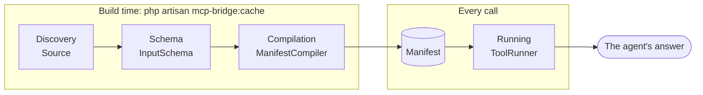

# How it works

A call goes through the same four steps whatever it came from, and each step is one object. Knowing the steps tells you where to look when something is not as you expected.

## Glossary

| Term | Meaning |
| --- | --- |
| Source | One kind of thing that can become a tool: routes, commands, jobs, actions, models, resources, remote servers or OpenAPI documents. A source finds candidates and runs calls, and never decides whether a call is allowed. |
| Candidate | Something a source found that could become a tool, such as one route or one command. A candidate is either compiled into a tool or refused with a reason, which `mcp-bridge:tools --refused` shows. |
| Manifest | The compiled list of tools, with each tool's name, schema, safety, authority and server. Written to `bootstrap/cache/mcp-bridge.php` by `mcp-bridge:cache`, or compiled on first use when there is no file. |
| Authority | What the actor needs before a tool runs: the route's own middleware and policies for a route tool, and a declared scope plus a Gate ability for everything else. |
| Scope | A string a token holds, such as `courses:read`, checked against `#[McpScope]`. It answers "was this credential granted this", and it is decided when the token is issued. |
| Ability | A Gate ability, checked against `#[McpAbility]`. It answers "may this user do this", and your application's own Gate decides it on every call. |
| Server | One MCP endpoint, configured under `servers`, with its own path, middleware and tool surface. Every tool is served from exactly one server. The shipped pair are `default` (`/mcp`) and `ops` (`/mcp/ops`). |
| Actor | The user a call runs as, once it is resolved: the holder of the token under `passthrough`, the configured account under `service-account`, `security.local_actor` over stdio. Policies, Gate abilities and the audit trail all answer about the actor. Before resolution, the connection is the caller. |
| Package token | A token this package issues (`McpToken`, prefixed `mcpb_`), read by the `mcp-bridge` guard. A Sanctum token is Sanctum's own. |

## The four steps



The first three happen at build time, when you run `php artisan mcp-bridge:cache`, or on first use when no manifest is cached. Running happens on every call.

## 1. Discovery

A `Source` finds candidates. There are eight: `route`, `command`, `job`, `action`, `model`, `resource`, `remote` and `openapi`. A source:

- **finds** things that could become tools, as `ToolCandidate` objects, in a stable sorted order so an unchanged application always compiles to an identical manifest;
- **builds** the input schema for a candidate;
- **validates** a candidate and returns the reasons it may not be exposed, as `Refusal` objects, so a found-but-hidden candidate stays visible to the lint instead of vanishing;
- **executes** a call when asked.

A source never decides whether a call is allowed and never shapes its own output. That is what stops eight sources from becoming eight security models. See [the sources](/sources/) for what each one finds and what it needs.

Discovery reads your code with reflection and static analysis, so `mcp-bridge:cache` never calls a controller and never queries your database. A few steps do run code or reach the network, because the declaration lives there:

- `rules()` is called on a FormRequest, a `spatie/laravel-data` class or an action that declares it, on a plain instance with no request behind it. A `rules()` that depends on request state degrades to no rules, and the lint reports it.
- Remote MCP servers are asked for their tool lists, and OpenAPI documents given as URLs are fetched, when the manifest compiles.
- With `integrations.scramble.responses` on, Scramble's generator runs over every documented route to infer the responses.

## 2. Schema

Each candidate's input schema is built in layers that merge into one `InputSchema`, later layers winning per field:

1. Route parameters.
2. Validation rules, from the FormRequest or from `#[McpInput]`.
3. API documentation attributes, from Scramble or Scribe.
4. The allowed query of a list endpoint: Spatie chains, query attributes, or a shared definition.
5. This package's own attributes, chiefly `#[McpParam]`.
6. Application-filled fields: `security.fill_from_auth` hides them, for every source.

`JsonSchemaCompiler` turns the result into `Illuminate\JsonSchema` types as the very last step, so everything before it works on one representation. Each field records which layers touched it, which is what lets the lint notice when your REST documentation and your agent schema disagree. [Schema inference](/concepts/schema) covers the layers one by one.

## 3. Compilation

`ManifestCompiler` names, authorises, limits and groups each candidate once, into a `ToolDefinition`. For every candidate from every enabled source it:

1. asks the source to validate, and asks `AuthorityRequirement` whether a non-route candidate declares a scope and an ability;
2. gives refused candidates a reason and moves on;
3. resolves the module the code lives in, and applies the module prefix if configured;
4. refuses a candidate with `MCP_BRIDGE_NAME_TAKEN` when an earlier one already holds its tool name, so a collision costs one tool and never the build; sources compile in the fixed order in [collisions](/concepts/naming#collisions);
5. builds the description, which carries the safety note, the scopes needed, any `#[McpExample]` and the deprecation notice, because the description is the only text an agent reads;
6. adds the `confirm` input to any tool that needs confirmation;
7. assigns limits (timeout and rate limit) and the server the tool belongs on, by the order in [where a tool lands](/guide/servers-and-modules#where-a-tool-lands).

The result is written by `mcp-bridge:cache` to `bootstrap/cache/mcp-bridge.php`, a plain exported PHP array that OPcache keeps warm, like route caching. It carries a format version: a manifest written by a different version of the package is treated as absent, so it is rebuilt rather than misread.

A connected client is served from that file when it exists, so a file that predates a change lists the old surface: see [keeping the manifest current](/guide/operations#keeping-the-manifest-current).

The [testing helpers](/guide/testing) are the exception: they compile fresh, because a test asks whether the code is right, and a stale manifest would answer about the last build.

## 4. Running

`ToolRunner` is the one path. It does four things, in order: authorise, execute through the source, shape, record.

```
client call
  -> GeneratedTool::handle()        resolves the actor, strips confirm and idempotency_key from the arguments
  -> ToolRunner::run()
       ScopeGate::check()           kill switch, scopes, abilities, rate limit, confirmation
       IdempotencyKeys::claim()     replay a retried write instead of running it twice
       execution.middleware         your classes: tenancy, tracing, metering
       Source::execute()            route | command | job | action | model | remote | openapi
       OutputShaper / ErrorMapper   unwrap, redact, trim, or map the failure
       AuditRecorder + ToolCalled   one audit row and one event, whatever happened
  -> structured content + text back to the client
```

`confirm` and `idempotency_key` are inputs the agent sees and the code behind the tool never does: `GeneratedTool::handle()` takes them out of the arguments and hands them to the runner separately. An idempotent replay answers before the [middleware](/reference/php-api#middleware-around-a-call) runs, and an exception thrown by a middleware, the source or the shaping is caught by the runner and answered as `MCP_BRIDGE_SERVER_ERROR` (see [errors](/concepts/output-and-errors#errors)).

A connected client, `mcp-bridge:call` and the [testing helpers](/guide/testing) all go through `ToolRunner`, and none of them may skip it. If each spelled the sequence out, the two that are not the real path would drift from it, and a test that proved a tool was refused would be proving something else.

Three properties of this step are worth knowing:

- **Route calls are real requests.** `RouteExecutor` builds a request on the outer request's host with the caller's address, sets `Accept: application/json`, adds `X-Request-Id`, `X-Mcp-Tool` and `X-Mcp-Client` headers, forwards the outer `Authorization` header and the `execution.forward_headers`, and hands it to the HTTP kernel, so global middleware and the exception handler apply as they would for a REST client. Your code can [detect an agent call](/reference/php-api#the-facade) without forking a controller.
- **State is isolated.** The outer request and the resolved user are captured before the call and restored after it.
- **Failures are mapped.** Validation errors, missing records, authorisation failures and server errors come back as tool errors an agent can act on. See [output and errors](/concepts/output-and-errors).

## On top of laravel/mcp

The package builds on the official [`laravel/mcp`](https://github.com/laravel/mcp) package and never replaces it. Transport, protocol negotiation, OAuth, tool search and MCP Apps stay with it. Each configured server becomes a `Mcp::web()` endpoint and, when `local` is on, a `Mcp::local()` stdio handle, both backed by `GeneratedServer`, which fills `laravel/mcp`'s tool, resource and prompt lists from the compiled manifest. `php artisan mcp:start <server>` serves the one you name, as the user `security.local_actor` names. A definition plus `GeneratedTool` is enough: there is no generated class per route.

## Where to look when

| Symptom | Step | Command |
| --- | --- | --- |
| A tool is missing. | Discovery or compilation. | `mcp-bridge:tools --refused` |
| The agent sends the wrong inputs. | Schema. | `mcp-bridge:export --format=markdown` |
| A call is refused. | Running, the gate. | `mcp-bridge:call <tool>` |
| The answer looks wrong or truncated. | Running, shaping. | `mcp-bridge:call <tool>` |
| A change is not reflected. | The manifest is stale. | `mcp-bridge:cache` |
