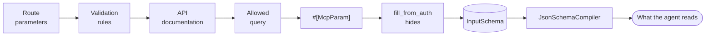

# Schema inference

The package's central bet is that you have already written the schema. A FormRequest says what a valid write looks like, a route says which parameters it takes, a command signature names its arguments and options, a constructor types its parameters. The work is deciding **what to expose**, not describing it again.

## The layers

For a route, the layers merge in this order, and a later layer wins per field:

| # | Layer | Reads |
| --- | --- | --- |
| 1 | Route parameters | `{course}` placeholders, route model binding and `where*` constraints. |
| 2 | Validation rules | The FormRequest type-hinted by the action, or the one named by [`#[McpInput]`](/reference/attributes#mcpinput). |
| 3 | API documentation | Scramble attributes and Scribe docblock annotations. See [documentation packages](/guide/documentation-packages). |
| 4 | The allowed query | Spatie chains, query attributes or a shared definition. See [list endpoints](/guide/list-endpoints). |
| 5 | This package's attributes | [`#[McpParam]`](/reference/attributes#mcpparam), the most specific layer. |
| 6 | Application-filled fields | `security.fill_from_auth` hides them, for every source. |



Later layers win per field, not per schema: a rule that types `status` as a string and an `#[McpParam]` that gives it an enum produce one field with both, and the field remembers every layer that touched it. `JsonSchemaCompiler` then turns the merged `InputSchema` into `Illuminate\JsonSchema` types, which is the only shape `laravel/mcp` accepts.

Other sources start from a different first layer:

| Source | Schema comes from |
| --- | --- |
| Command | The signature: arguments, options, flags and `*` lists, with their descriptions and defaults. Global console options are left out. |
| Job | The constructor's typed parameters. |
| Action | `rules()` when the action has them, otherwise `handle()` or `__invoke()` parameters. |
| Model | `$fillable` and casts for writes, the key for `get` and `delete`, and the query layer for `list`. |
| Remote | The remote tool's own `inputSchema`, as it stands. |
| OpenAPI | The operation's `path` and `query` parameters and its `application/json` request body, with references resolved. See [OpenAPI documents](/sources/openapi#the-schema-comes-from-the-document). |

## From validation rules

The rule reader understands the common rules and records what it cannot express, rather than dropping it.

| Rule | Becomes |
| --- | --- |
| `required`, `nullable` | Required and nullable flags. |
| `string`, `integer`/`int`, `numeric`/`decimal`, `boolean`/`bool`/`accepted`/`declined` | A typed field. |
| `array`, `list` | An object or an array. |
| `email`, `url`, `uuid`, `ulid`, `ip`, `date` | A string with the matching `format`. |
| `in:a,b,c` | An `enum`. |
| `min`, `max`, `size`, `between` | Bounds, interpreted by the field's type. |
| `regex` | A `pattern`. |
| `exists:table,column` | A description: "The id of an existing ...". |
| `file`, `image`, `mimes`, `mimetypes`, `dimensions` | A staged-upload id. See [file uploads](/guide/uploads). |
| `confirmed`, `date_format`, `after_or_equal`, `before_or_equal` | Kept in the description, because the schema subset cannot express them. |

A custom rule object becomes a note on the field saying no schema can express it, unless a class in `schema.rule_mappers` says what it means. See [`MapsRules`](/reference/php-api#mapping-your-own-validation-rules).

Dotted rules (`address.city`) become nested paths, and wildcard rules (`items.*.sku`) become arrays of items. A `rules()` method that depends on request state degrades to no rules instead of throwing, and the lint reports it.

Inputs travel to the route the way the verb implies: `GET` and `DELETE` inputs go in the query string, everything else in a JSON body, and path parameters are substituted into the URI.

## Refining a field

Use [`#[McpParam]`](/reference/attributes#mcpparam) to describe, retype, constrain, give an example to, or hide one field by its dot path. It is the most specific layer, so it beats rules, route parameters and documentation attributes.

```php
use KayedSpace\McpBridge\Attributes\McpParam;
use KayedSpace\McpBridge\Attributes\McpTool;

#[McpTool(description: 'Revenue by course.')]
#[McpParam('from', description: 'Start date, inclusive.', example: '2026-01-01')]
#[McpParam('currency', enum: ['usd', 'eur'], type: 'string')]
#[McpParam('internal_flag', hidden: true)]
public function index(): JsonResponse { /* ... */ }
```

Refine; do not duplicate. A second schema beside the FormRequest is the duplication this package exists to remove.

When an action validates inline or type-hints a plain `Request`, name the rules source with [`#[McpInput]`](/reference/attributes#mcpinput):

```php
#[McpTool(description: 'Create a course from an inline validated request.')]
#[McpInput(CourseStoreRequest::class)]
public function storeInline(Request $request): JsonResponse { /* ... */ }
```

A [`spatie/laravel-data`](https://github.com/spatie/laravel-data) class is a rules source wherever a FormRequest is: name one with `#[McpInput]`, or type-hint one on an action's `handle()` or a job's constructor. Its property types and validation attributes are read through the object's own `getValidationRules()`, and a parameter typed as one is built with `validateAndCreate()` from the flat arguments, so the agent sees the object's fields rather than a nested object to guess the shape of.

## What the schema cannot express

The JSON Schema subset `laravel/mcp` accepts has no `oneOf`, `const`, `exclusiveMinimum` or `additionalProperties` schema. Anything a field cannot express stays in its description instead of vanishing, so the agent still reads the constraint.

A job or action parameter with no type, a closure, or an interface that is not a model cannot be built from JSON. Rather than expose a tool that fails on its first call, the candidate is refused at compile time with the parameter and the reason named. Fix it by typing the parameter, or keep the class out with `#[McpIgnore]`.

## Seeing the result

```bash
php artisan mcp-bridge:export --format=markdown
php artisan mcp-bridge:export --format=json --path=storage/tools.json
```

`export` compiles fresh and writes every tool with its description, target, safety, scopes and visible inputs. Read it the way an agent would. The `schema` resource lists the same thing over the protocol for connected clients; hidden fields are left out of both.
