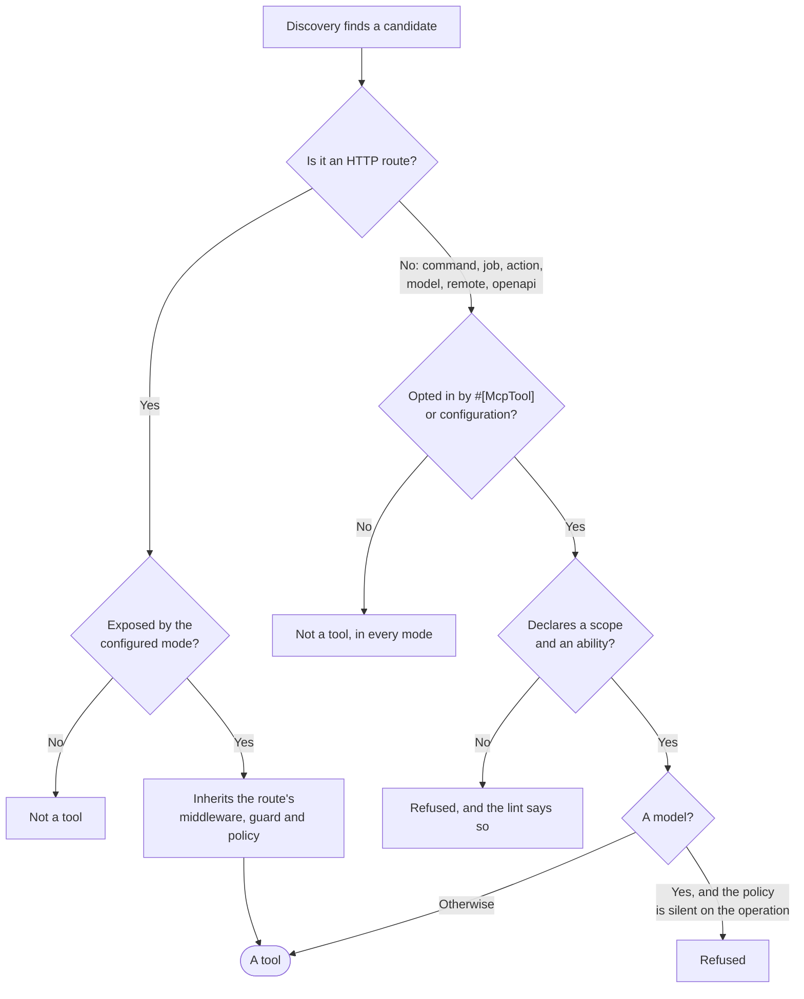
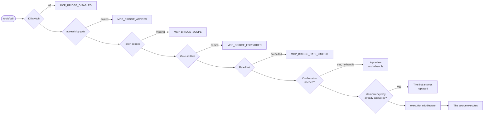
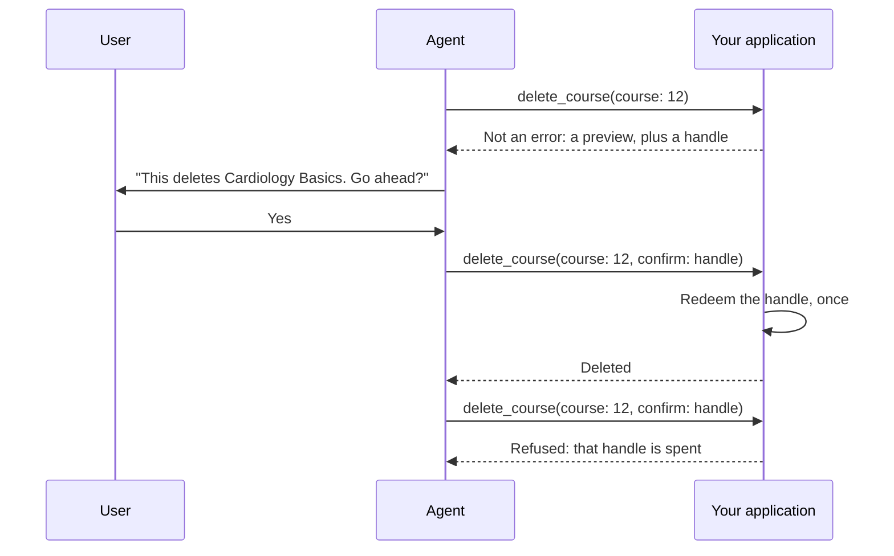

# The security model

Every tool is something an agent can reach into your application with. So exposure is opt-in, and authority is explicit. This page states each rule, where it is enforced and what to do about it. Read it before you expose anything that is not an HTTP route.

## The rules

1. **Only HTTP routes follow the configured `mode`.** A route arrives wrapped in middleware, a guard and usually a policy, and a tool call inherits all of it.
2. **Every other source is opt-in per item, in every mode**, and must declare both `#[McpScope]` and `#[McpAbility]`. Model tools additionally need a policy with a method for the operation.
3. **Scopes and abilities are checked when listing and again when calling**, because hiding a tool is not enforcement.
4. **A guard that cannot report token abilities fails closed.**
5. **Confirmation handles are single use**, bound to the tool, the actor and the exact arguments.

The asymmetry in rules 1 and 2 is the whole model. A route brings its own protection and a tool call inherits it; nothing else has any to inherit, so it has to be granted:



Every refusal above happens at build time, so a tool that should not exist never reaches a client at all. The checks that run on every call are [further down](#scopes-and-abilities-are-checked-twice).

## What each source needs

| Source | Exposure | Declares authority | Extra requirement |
| --- | --- | --- | --- |
| Route | Follows `mode` (`opt-in`, `opt-out`, `read-only`). `#[McpIgnore]` always wins. | Optional. The route's own middleware and policies apply. | None. |
| Command | `#[McpTool]` on the class, in every mode. | `#[McpScope]` and `#[McpAbility]`, mandatory. | Not on the deny list, inside `sources.command.namespaces`. |
| Job | `#[McpTool]` on the class, in every mode. | Mandatory. | Constructor buildable from JSON. |
| Action | `#[McpTool]` on the class, in every mode. | Mandatory. | Signature buildable from JSON, or `rules()`. |
| Model | `#[McpTool]` on the model, in every mode. | Mandatory. | A registered policy with a method for each operation. |
| Resource | Listed in `sources.resource.expose`, on servers that list `resource` in `sources`. The `records` template goes instead to every server that carries a model `get` tool. | `sources.resource.scopes`, checked on listing and on reading: `*` is any authenticated caller, `[]` is nobody. The server's middleware runs first, and a `records` read also passes the `get` tool's own gate. | None. |
| Remote | Configured under `sources.remote.servers`, narrowed by `only` and `except`. | `scopes` and `abilities` in that config block, mandatory. | None. |
| OpenAPI | Configured under `sources.openapi.documents`, narrowed by `only` and `except`. | `scopes` and `abilities` in that config block, mandatory. | A JSON request body, or none. |

Which endpoint each tool is served from is decided separately; see [where a tool lands](/guide/servers-and-modules#where-a-tool-lands). With the shipped configuration only route tools are on `default`, and everything else is on `ops` behind `auth:mcp-bridge`.

## Routes follow the mode

`mode` in `config/mcp-bridge.php` decides which routes become tools:

| Mode | Behaviour |
| --- | --- |
| `opt-in` (default) | Only routes whose controller or action carries `#[McpTool]`. |
| `read-only` | Opted-in routes, plus every discovered route whose safety is read-only (`GET`). Writes still need the attribute. |
| `opt-out` | Every discovered route, except what is `#[McpIgnore]`d or excluded from your API docs. |

`#[McpIgnore]` wins over every opt-in, in any mode. A route that your documentation package excludes (`#[ExcludeRouteFromDocs]` in Scramble, `@hideFromAPIDocumentation` in Scribe) is also kept out when `discovery.respect_docs_exclusions` is on, which is the default.

Before a route is even a candidate, it must pass the structural filter: a controller action rather than a closure, an HTTP method in `discovery.methods`, a URI under `discovery.prefixes` and matching `discovery.include` and not `discovery.exclude`. `HEAD` and `OPTIONS` are never tools. When a route accepts both `PUT` and `PATCH`, they collapse into one update tool.

::: warning Do not set `mode` to `opt-out` to save typing
It exposes every matching route, including ones nobody reviewed. It is a deliberate posture for an application whose entire API is meant to be agent-reachable.
:::

A route tool executes as an in-process request through the HTTP kernel. The global middleware, the route's middleware, FormRequest validation and policies all run, exactly as for a REST client, and a failure inside them is rendered by your exception handler and comes back as a mapped tool error. The tool adds nothing the route did not already allow. It can only remove: a missing scope or ability, a rate limit, a kill switch or an unconfirmed destructive call stops the request before it is built.

## Everything else is opt-in and needs authority

A command, job, action or model has no middleware to inherit. Its implicit identity would be the server operator, so inheriting that would be privilege escalation by design. These sources are therefore opt-in per item in every mode: `mode` is never consulted for them, and no configuration switches them to opt-out.

An item is opted in by `#[McpTool]` and must declare what an actor needs:

```php
use KayedSpace\McpBridge\Attributes\McpAbility;
use KayedSpace\McpBridge\Attributes\McpScope;
use KayedSpace\McpBridge\Attributes\McpTool;

#[McpTool(description: 'Recalculate course statistics for a date range.')]
#[McpScope('ops:write')]
#[McpAbility('run-reports')]
class RecalculateStats extends Command { /* unchanged */ }
```

`#[McpScope]` names a token scope. `#[McpAbility]` names a Gate ability, so your application's own Gate answers "who may", not this package. Both are repeatable, and every one listed must hold.

The two halves live where they always live in Laravel. The ability is a Gate definition in a service provider, and the scope is on the token the agent connects with:

```php
// app/Providers/AppServiceProvider.php
Gate::define('run-reports', fn (User $user): bool => $user->isOps());
```

```bash
php artisan mcp-bridge:token ops@example.com --name="Claude for ops" --scopes=ops:write --expires=7d
```

A token issued without `ops:write` does not see the tool and cannot call it; a user the Gate denies is refused even with the scope. Try the tool from the shell as that token would see it with `php artisan mcp-bridge:call recalculate_stats --as=ops@example.com --scopes=ops:write`.

An opted-in candidate with neither is not exposed. It is refused with `MCP_BRIDGE_SOURCE_REFUSED` and the message "needs both #[McpScope] and #[McpAbility] because it is not an HTTP route", and [`mcp-bridge:lint`](/reference/commands#mcp-bridge-lint) reports it as an error, because you meant to expose it.

`security.require_scope_for_non_http` (default `true`) is the switch behind this rule. Do not turn it off. It is the only thing standing between an agent and an unprotected command. The rule is shared by the compiler and the lint through one class, so the lint can never call a tool fine that the compiler would refuse.

### Models also need a policy

A model tool exists only when the model opts in, the authority is declared, **and** a policy is registered **and** that policy has a method for the operation. A policy that does not answer for an operation did not mean to allow it, so that operation produces no tool and the refusal says which method is missing. At run time the policy is asked about the record, wherever a record exists. `sources.model.require_policy` (default `true`) controls this check. The operation-to-method table and the rules for writes are on the [models page](/sources/model#what-it-needs-to-be-opted-in).

```php
#[McpTool]
#[McpScope('courses:write')]
#[McpAbility('manage-catalogue')]
class Course extends Model { /* ... */ }

class CoursePolicy
{
    public function viewAny(User $user): bool { return true; }
    public function view(User $user, Course $course): bool { return true; }
    public function create(User $user): bool { return $user->isEditor(); }
    // No update or delete: those operations produce no tool.
}
```

With `sources.model.enabled` on and the default operations, this gives `model_list_courses` and `model_get_course`; `model_create_course` appears once `create` is added to `sources.model.operations`, and asks `CoursePolicy::create` on every call.

A model tool filters, sorts and writes only the `$fillable` columns the model does not hide and `security.redact` does not name. A column kept out of the output would otherwise still leak through a filter or a sort, and still be settable through a write: a `User` opted in offers nothing on `password`. A write to such a column is declared on purpose with `#[McpInput]`. Details are on the [models page](/sources/model#the-schema-comes-from-the-model).

Model tools are named with the `model_` prefix (`model_get_course`), so that a model never takes, or loses, the name of the route in front of it. See [source prefixes](/concepts/naming#source-prefixes).

### Commands are bounded further

Static analysis cannot tell what an arbitrary command touches, so the command source bounds the blast radius instead:

- A **deny list that holds even for a command someone opted in**, with a built-in floor that emptying `sources.command.deny` cannot lift. The floor, and the one escape hatch, are on the [commands page](/sources/command#the-deny-list).
- A **namespace allowlist**, `sources.command.namespaces`. The shipped `['*']` lets any namespace opt in, and an empty list lets none. Naming them is the production posture.
- Commands are **destructive by default**, so with `security.destructive` at `confirm` a command tool asks before it runs. Say `#[IsReadOnly]` (from `laravel/mcp`) when a command only reads.
- Interaction is off (`--no-interaction`), so a command that prompts fails rather than hangs.

### Remote and OpenAPI tools carry this application's authority

A tool re-exported from another MCP server declares `scopes` and `abilities` in `sources.remote.servers.<name>`, and an OpenAPI operation in `sources.openapi.documents.<name>`. The credential the other service is reached with is never revealed to the agent. A block with neither is refused like any other non-HTTP candidate.

## Who may use MCP at all

Define an `accessMcp` gate to decide which accounts may use your MCP servers at all, for example only paying subscribers. Until the gate exists it decides nothing.

```php
use Illuminate\Support\Facades\Gate;

Gate::define('accessMcp', fn (User $user, string $server): bool => match ($server) {
    'ops' => $user->isAdmin(),
    default => $user->subscribed(),
});
```

The gate receives the server's key, so `default` can follow a subscription while `ops` stays with staff. It covers every source on the server, not only routes. It is asked before scopes and abilities, on every listing and every call: an account it denies sees no tools, and a call answers `MCP_BRIDGE_ACCESS`. Because it is asked on each call, a subscription that lapses takes effect on the next request, with no token to revoke.


### With middleware instead

The same rule can live in middleware, in one of two places.

**On the MCP server**, in `servers.<key>.middleware` after the guard. It runs on every request to that endpoint, listing included, for every source, so it needs no check that the request is an MCP call:

```php
class EnsureSubscribed
{
    public function handle(Request $request, Closure $next): Response
    {
        abort_unless($request->user()?->subscribed(), 403, 'MCP access needs an active subscription.');

        return $next($request);
    }
}

// config/mcp-bridge.php
'middleware' => ['auth:mcp-bridge', 'throttle:mcp', EnsureSubscribed::class],
```

**On your own routes**, with `$request->isMcp()`, so agent calls are refused while browser and REST traffic pass:

```php
public function handle(Request $request, Closure $next): Response
{
    if ($request->isMcp() && ! $request->user()?->subscribed()) {
        abort(403, 'MCP access needs an active subscription.');
    }

    return $next($request);
}
```

The gate is still the better fit for most applications. Middleware on the server answers with an HTTP error for the whole connection rather than a refusal the agent can read, and middleware on routes covers route tools only and leaves them listed. The gate hides the tools, covers every source and transport, and refuses each call with `MCP_BRIDGE_ACCESS`.

## Scopes and abilities are checked twice

A tool whose scope or ability the actor lacks is **not listed**. That is `GeneratedTool::shouldRegister()`, answered by the same `ScopeGate` that runs on a call. Listing is a courtesy: a client that cached a tool list a minute ago, or one that guesses a name, still reaches the second check.

On every call, `ScopeGate::check()` runs, in this order, each gate refusing earlier than the last:



Only then does the source execute. Each gate answer (`MCP_BRIDGE_DISABLED`, `MCP_BRIDGE_ACCESS`, `MCP_BRIDGE_SCOPE`, `MCP_BRIDGE_FORBIDDEN`, `MCP_BRIDGE_RATE_LIMITED` and the preview with its handle) is written to the audit trail and fires a `ToolCalled` event with the outcome `refused`, so a refusal is as visible as a success. A replay is answered after the gate and before any [middleware](/reference/php-api#middleware-around-a-call), so a token that lost its scope is refused rather than replayed. The same runner serves a connected client, `mcp-bridge:call` and your tests, so none of them can skip a step.

### A guard that cannot report abilities fails closed

For a tool that declares a scope, `TokenScopes` asks in this order, and never assumes a yes:

| The actor | What is asked | Refused with |
| --- | --- | --- |
| Holds a package token (`currentMcpToken()`, set by the `mcp-bridge` guard) | The package token's scopes. | "needs the scope [...]" |
| Has no package token but has `tokenCan()` (Sanctum's `HasApiTokens`, Passport) | `tokenCan($scope)`. | "needs the scope [...]" |
| Has `HasMcpTokens` and no `tokenCan()`, and holds no token (a session, a factory) | Nothing: there is no credential. | "the caller holds no token" |
| Has neither `currentMcpToken()` nor `tokenCan()` | Nothing: the guard cannot answer. | "the current guard cannot report token abilities" |

An unauthenticated caller is refused too. A user without a credential holds no scopes because answering yes would turn a token check into no check at all. A token issued with an empty scope list holds nothing either; only `*` holds everything.

## There is no unauthenticated tool

Every call resolves a real actor and runs as them, because every authority question here is answered by your own Gate and policies about that actor, and no setting relaxes this. For a public MCP tool, write one with `laravel/mcp` directly.

## Who a call runs as

Two strategies, because two kinds of thing connect.

`passthrough`, the default, runs each call as the holder of the token that made it. A person who connects their own AI client acts as themselves, their policies answer about them, and the audit trail names them.

`service-account` runs every call on the server as one configured user. A nightly recalculation, an n8n flow or a sales agent is nobody's personal action, and attributing it to whoever happened to issue the token misattributes everything it does.

```php
'security' => [
    'auth' => 'service-account',
    'service_account' => 'automation@example.com',
],
```

The account must be a **real user record with real policies**, never a convention-based superuser. Every authority question in this package is answered by the application's own Gate, and a fabricated actor gives the Gate nothing to answer about.

If the configured account does not resolve, the call is refused and the message says why. It does not fall back to the token holder: silently reverting to passthrough would run an automation as a person, which is the one outcome this setting exists to prevent.

A stdio server is the third case: `passthrough` with nobody to pass through, because a subprocess carries no token.

- **Who it runs as.** `security.local_actor` names the user, by id or email.
- **When it is read.** Only for a server started with `php artisan mcp:start`, and only when nothing authenticated the caller, so it can never widen an HTTP surface.
- **When it is not read.** Under `service-account`, which already names one actor for every transport.
- **Why configuration decides.** Whoever can run `php artisan` is already inside the application, so the choice is made in configuration rather than guessed.
- **When it is missing.** With `local` on and no local actor named, every stdio call is refused with a message that names the key, and `mcp-bridge:doctor` reports it before anyone connects.

```php
'local' => true,
'security' => [
    'local_actor' => 'you@example.com',
],
```

For OAuth, point the server's middleware at laravel/mcp's OAuth guard. Its built-in flow advertises a single `mcp:use` scope, so fine-grained per-tool scopes still come from package tokens or Passport token scopes, which this package maps onto tools either way.

## Requiring a policy

`security.require_policy` refuses any write tool whose bound model has no registered policy, route tools included.

```php
// config/mcp-bridge.php
'security' => [
    'require_policy' => true,
],
```

With it on, `POST api/courses` binding `Course` becomes a tool only once a `CoursePolicy` is registered, and `mcp-bridge:tools --refused` names the model the policy is missing for.

This is stricter than Laravel itself, where a route without a policy is a route without a policy and the controller is trusted to have thought about it. An endpoint an agent reaches is worth holding to a higher bar than one a developer wrote a form for, and this is the switch for saying so. It is off by default, because on is a change to what your existing routes expose.

It reads bound models only. A route that binds nothing has no model for a policy to be missing from, and inferring one from the URI would refuse tools over a guess.

## Destructive calls and confirmation

Safety is inferred where it can be done with confidence and declared everywhere else:

| Source | Default |
| --- | --- |
| Route | From the verb. `GET` is read-only and idempotent. `PUT` is idempotent. `DELETE` is destructive. `POST` and `PATCH` are none of these. |
| Command | Destructive, unless `sources.command.destructive_by_default` is `false` or the class says `#[IsReadOnly]` or `#[IsDestructive(false)]`. |
| Job, action | Not destructive. The declaration decides. |
| Model | From the operation: list and get are read-only, update is idempotent, delete is destructive. |
| Remote | The remote's own `readOnlyHint`, `destructiveHint`, `idempotentHint` and `openWorldHint`. A missing destructive hint counts as destructive. |
| OpenAPI | From the verb, as for a route. |

Override any of it with `laravel/mcp`'s `#[IsReadOnly]`, `#[IsDestructive]`, `#[IsIdempotent]` and `#[IsOpenWorld]`, which this package consumes and never redeclares.

A destructive tool needs confirmation when `security.destructive` is `confirm` (the default). `#[McpConfirm]` asks for confirmation regardless of that setting, and carries the message the user sees.

`security.destructive` has three behaviours:

| Value | Effect |
| --- | --- |
| `confirm` | The default. A destructive tool is exposed and asks before it runs. |
| `allow` | A destructive tool is exposed and runs without asking. `#[McpConfirm]` still applies per tool. |
| `deny` | A destructive tool is never exposed. It appears under `mcp-bridge:tools --refused` with the reason, and the lint reports it. |

`deny` is a floor for a whole environment: a production deployment can refuse every destructive tool without having to audit which ones were opted in. It applies to routes as well, since a destructive route is the case it most needs to cover.

The protocol is stateless, so confirmation is a two-step handshake rather than an error, and the handle carries its own contents:

1. The agent calls the tool. The result is not an error. It carries a preview, `errorCode` `MCP_BRIDGE_CONFIRMATION_REQUIRED` and structured content `confirmation: { required, handle, expires_in }`. The handle is in the preview text as well, so a client that reads only text can confirm.
2. The user agrees. The agent calls again with the handle in the `confirm` argument.

The preview and the confirmed call each count against the tool's rate limit, because each is a call the gate answered.



The last two lines are the point of the handshake. A dropped connection and a retry is the normal case, not the adversarial one, and it must not delete twice.

The handle is encrypted with the application key and carries its own contents: the tool name, the actor, a fingerprint of the arguments and an expiry. So it survives Octane workers and several app servers, and:

- changing any argument invalidates it;
- it works only for the tool it was issued for and the actor it was issued to;
- it expires after `security.confirm_handle_ttl` (default `5m`);
- **it is good once.** Spending it writes a marker to the cache with `Cache::add`, which succeeds for exactly one of two racing calls, so an agent that retries a dropped connection cannot delete twice;
- it fails closed: when the cache cannot answer, a handle is not honoured, because a cache that cannot answer cannot promise single use.

A handle that was used, expired, forged or issued for different arguments answers `MCP_BRIDGE_CONFIRMATION_EXPIRED`, and the agent should call the tool again without it to get a fresh preview. Writes that are not destructive are protected against retries by an [idempotency key](/concepts/output-and-errors#retries-and-idempotency-keys) instead.

::: warning A shared, unflushed cache is part of the guarantee
Single use depends on `Cache::add` being atomic across every process that serves `/mcp`, and on the spent marker surviving until the handle expires. Run a shared store (Redis, database, Memcached) in production, never the `array` or `null` driver; `mcp-bridge:doctor` fails on either. A cache flushed within the handle's lifetime (five minutes by default) forgets the marker, so a spent handle can be presented again until it expires.
:::

## Tenancy

A route tool runs through the HTTP kernel on the caller's host and path, so tenancy that a middleware initialises from the domain or the URL is initialised for it, as for any request. A command, job, action or model tool runs no HTTP middleware, so nothing initialises a tenant for it unless something is told to. That something is `execution.middleware`: a class that runs after the gate and before the source, with the call in hand, where a tenant is resolved from the actor and a call that belongs to no tenant is stopped. See [middleware around a call](/reference/php-api#middleware-around-a-call).

## Identity and authority outlive dispatch

- **The actor is the authenticated user.** Commands run inside `McpBridge::actingAs()`, so `auth()->id()` inside the command is the actor, not nobody. Code that reads "no user" as "system, allow everything" would otherwise grant an agent more than it has. Actions, models and job dispatch run as the actor too, and the previous guard state is restored afterwards.
- **State does not leak between calls.** Every executor snapshots the outer request and user and restores them afterwards, which is what keeps a long-lived Octane worker from answering with the wrong user.
- **A queued job asks again when it runs.** With `sources.job.reauthorize` on (the default), a job that declares abilities carries middleware that re-checks the Gate in the worker. Revoking a token or an ability stops work the agent already queued, and the job fails with `JobNoLongerAuthorized` instead of vanishing. A job that cannot carry the middleware (it declares `$middleware` as non-public) is refused at dispatch rather than run unchecked. Synchronous jobs are not re-checked, because they have already run.
- **Hidden fields.** Fields in `security.fill_from_auth` (default `user_id`, `created_by`) are present in the schema but never shown to the agent and never taken from it, on every source. A create (a `POST` route, a model `create`, a command, job or action) fills them with the actor's id. An update leaves them alone, because the policy that allowed the update was asked "may update" and never "may reassign". A remote or OpenAPI tool drops them: the other system's `user_id` is not this application's user. Per tool, `#[McpParam(name, fromAuth: true|false)]` adds a field to the list or exempts one.

## What leaves the application

- **Redaction.** Keys containing any entry of `security.redact` are removed from what the agent receives and masked in the audit trail, matched loosely by key name, and a model column it names is left out of the model source's filters, sorts and writes. Details and limits are in [redaction](/guide/audit-and-events#redaction).
- **Errors.** A 5xx never carries internals. `security.expose_error_details` (default `false`) appends the exception message; leave it off outside local development.
- **Cache hints.** `tools/list` is filtered per caller, so the cache scope is `private`. Asking for `public` is downgraded to `private` as soon as any tool on the server declares a scope or ability.
- **Resources.** There are five `app://` resources. Four describe an application's shape: `routes` and `schema` only describe what an agent can already reach, and `routes` names methods, URIs, route names and tools, never the controllers behind them. `schedule` and `config` say something about the application's behaviour and are off unless you list them in `sources.resource.expose`. `config` is a fixed, curated summary and never the configuration itself. The fifth, the `records` template, reads one record through a model `get` tool and is off unless listed too.
- **Resource scopes.** Resources take scopes of their own from `sources.resource.scopes`, checked when listing and again on the way in, for the same reason tools are: a client that listed a minute ago, or one that guesses a uri, reaches the read without listing at all. The shipped `['*']` leaves them open to any authenticated caller, and an empty list grants nobody. Every allowlist in the configuration reads that way, `*` for everything and `[]` for nothing, so a list never grants more than it says. A `records` read passes this check and then the `get` tool's own gate and policy, as described on the [resources page](/sources/resource#reading-one-record).

```php
'sources' => [
    'resource' => [
        'expose' => ['routes', 'schema'],
        'scopes' => ['ops:read'],
    ],
],
```

## Switching it off

The kill switch turns off one tool, a source, a server or everything, from the shell and without a deploy. It lives in a database table with no expiry, so a flushed cache does not turn anything back on, and it is checked on listing and on calling. The commands are in [operating in production](/guide/operations#the-kill-switch).

## Before you expose something

1. Is it a route? Then the route's middleware and policy are the authority. Check they are what you want an agent to have.
2. Is it anything else? Choose the narrowest scope and a real Gate ability, not one that always returns `true`.
3. Could it destroy data? Mark it destructive and let confirmation run. Add `#[McpConfirm('...')]` with a message that names the consequence.
4. Run `mcp-bridge:tools --refused` and `mcp-bridge:lint`, and pin the result with a [contract snapshot](/guide/testing#pinning-the-contract).
5. Issue tokens with only the scopes the agent needs.

## Related

- [Attributes](/reference/attributes) for `#[McpScope]`, `#[McpAbility]`, `#[McpConfirm]`, `#[McpRateLimit]` and `#[McpIgnore]`.
- [Configuration](/reference/configuration#security) for every key under `security`.
- [Audit and events](/guide/audit-and-events) for watching what agents do.
